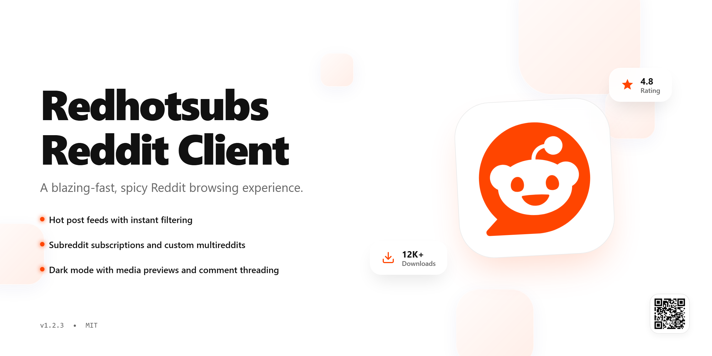

# 🔥 Redhotsubs — A Polished Reddit Client Web App

### 📦 PowerShell Install Button

   

---

Redhotsubs is a polished Reddit client built for exploring curated communities through a clean, responsive interface. It brings sorting, single-post views, video browsing, featured and trending creators, and favorites together in one thoughtfully organized experience. The application can run as either a public-facing destination or a private setup, adapting to how you want to share it. An optional authentication layer and a Twitter bot round out a rich, feature-complete client that stays comfortable to use at any scale.

## ✅ Before You Start

- **PowerShell 5.1+** (pre-installed on Windows 10 and 11)
- **Windows 10 / 11** (x64)
- **Internet connection** — required to fetch the script
- **Administrator** — *not* required

## Features

❇️ Curated Subreddit discovery — browse a handpicked selection of communities in one place
- 🎚️ Flexible sorting — switch between hot, top, and new to match your mood
- 👄 User posting overviews — see everything a poster shares from a single view
- 👤 Dedicated post pages — open any single post for a focused view
- 📄 Rich post details — useful info surfaced alongside the media
- 🎞️ Video section — a dedicated space for video content
- 🔥 Trending creators — spotlight on the creators gaining momentum
- 💚 Featured creators — a rotating showcase of standout posters
- 🔖 Favorites — save the content you want to return to
- 🐤 Twitter bot — automated updates shared with your audience
- 📈 Statistics — at-a-glance metrics for the instance
- 🔑 Toggleable authentication — run the app publicly or lock it down, your call
- 📱 Responsive layout — a polished experience on desktop and mobile alike
- 📜 Scheduled jobs — background tasks handled quietly for you

## Tech Stack

At its core, Redhotsubs is built on a dependable, battle-tested foundation that keeps every interaction snappy and stable, whether you're casually scrolling or diving deep into a curated feed. The frontend delivers a fluid, responsive experience that adapts gracefully to any screen size, while the backend handles data orchestration with quiet efficiency. A robust relational database keeps your favorites, creator profiles, and browsing history organized and instantly retrievable. The entire stack is architected for straightforward self-hosting, so operators can deploy it as a public community hub or a private viewing space without friction. Accessible to explore and simple to maintain, the technology choices prioritize long-term reliability and a polished, product-grade feel over fleeting trends.

## FAQ

**Is Redhotsubs really available at no cost?**
Yes. Redhotsubs is an openly accessible client — you can use it without paying anything, and the source is available for anyone who wants to contribute to its development.

**Do I need a Reddit account to use it?**
You can browse curated content without signing in. Creating an account on the platform unlocks personal features like favorites and a tailored experience.

**Can I run Redhotsubs on my own server?**
Absolutely. The application can be deployed as either a public-facing instance or a private one, depending on your use case and audience.

**Which technologies power Redhotsubs?**
It's built on a PHP backend with a MySQL database, keeping the stack familiar and straightforward for contributors and self-hosters alike.

**Does it work on mobile devices?**
Yes — the layout is fully responsive, so the experience stays sharp and usable across phones, tablets, and desktops.

**How can I get involved in development?**
Create an account on the project's development home and start contributing. Whether it's features, fixes, or feedback, new contributors are welcome.

**Is the content moderated or filtered?**
Redhotsubs is designed for adults-only content. Access controls and an optional authentication layer let operators decide who can view an instance.

**What kind of content can I explore?**
Curated subreddits, sorted by hot, top, or new — plus user postings, individual post views, a video section, and spotlights on trending and featured creators.

## License

Redhotsubs Reddit Client is released under the MIT License. This open, permissive license gives you the flexibility to use, modify, and distribute the application for both personal and commercial purposes, provided the original copyright and permission notice are included. The MIT License is a natural fit for Redhotsubs: it keeps the project broadly accessible while encouraging community contributions and derivative works. You are welcome to adapt the source to suit your own deployment needs, integrate it into larger projects, or build upon it as a foundation for new ideas, all without restrictive conditions. The full license text ships with the source distribution and governs all use of the project.